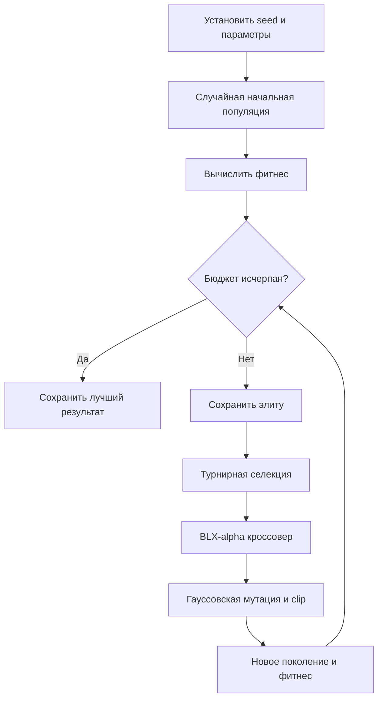
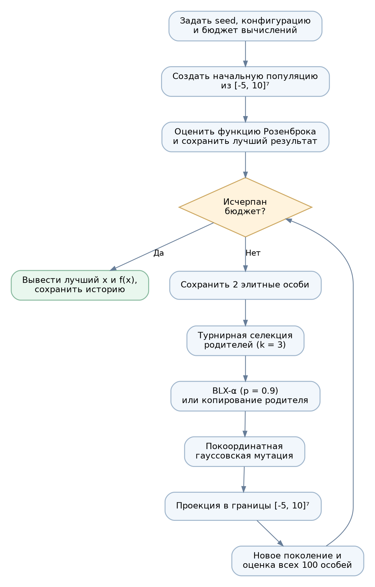
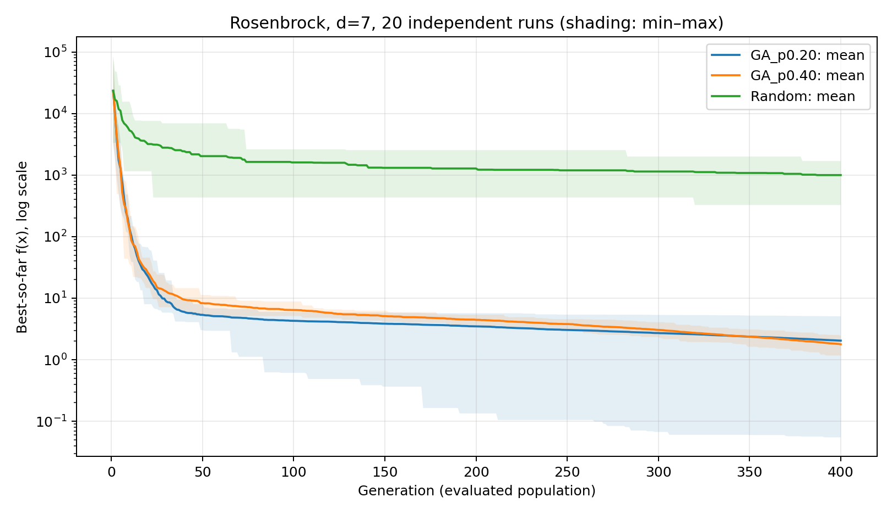
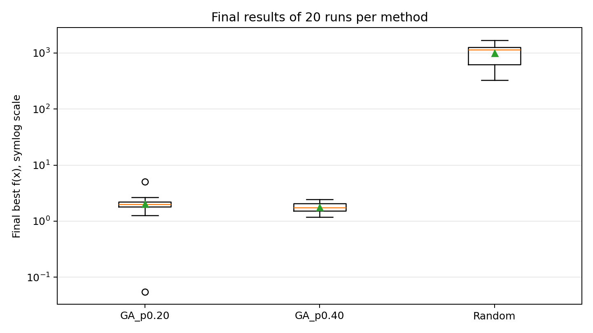

# Отчёт по лабораторной работе № 1

**Дисциплина:** Эволюционное программирование и генетические алгоритмы  
**Тема:** Многомерная оптимизация сложной функции генетическим алгоритмом  
**Группа:** Б24-507  
**Номер по списку:** 15  
**Вариант:** 2 (функция Розенброка)

## 1. Постановка задачи и определение варианта

Согласно методическим указаниям, N=15, Q=0 для группы 507, Y=26 для 2026 года.
По формуле V = 1 + ((17N + 7Q + Y) mod 20) получаем V = 1 + (281 mod 20) = 2.
Размерность d = 5 + (V mod 6) = 7.

Нужно минимизировать функцию Розенброка

$$f(x)=\sum_{i=1}^{6}\left[100(x_{i+1}-x_i^2)^2+(x_i-1)^2\right],$$

где $x\in[-5,10]^7$. Теоретический глобальный минимум равен 0 при $x=(1,1,1,1,1,1,1)$.
Все слагаемые функции неотрицательны, а при x=(1,...,1) обращаются в нуль.

## 2. Кодирование, ограничения, фитнес

Особь (генотип) представлена вещественным вектором длины 7; фенотип совпадает с генотипом, декодирование не требуется.
Допустимые решения лежат в гиперкубе [-5,10]^7. Начальная популяция генерируется равномерно в гиперкубе.
Фитнесом служит исходная целевая функция (меньше — лучше). После изменения координат применяется отсечение (`clip`) к допустимым границам.

## 3. Генетический алгоритм

Родители выбираются турниром из 3 случайных особей (побеждает меньший фитнес).
Рекомбинация BLX-α выполняется с вероятностью 0.9: для каждой координаты потомок выбирается равномерно из
$[\min(a_i,b_i)-\alpha|a_i-b_i|,\max(a_i,b_i)+\alpha|a_i-b_i|]$, где α=0.5.
Каждая координата потомка мутирует независимо с вероятностью p: к ней прибавляется шум N(0,σ²).
Для перехода от глобального к точному поиску σ геометрически уменьшается с 0.7 до 0.025 по поколениям.
После кроссовера и мутации потомок проецируется на границы области. Две лучшие особи каждого поколения переносятся без изменений (элитизм).
Турнирная селекция создаёт умеренное давление отбора: предпочитает перспективных родителей, но не исключает разнообразие.
Элитизм удерживает лучшие найденные решения от потери при случайной мутации и рекомбинации;
это важно при поиске вдоль узкой изогнутой долины функции Розенброка.
Остановка происходит строго при фиксированном числе оценок функции, включая начальную популяцию.

### Блок-схема

*Рис. 1. Блок-схема эволюционного цикла (приложена также как PNG для просмотра без Mermaid).*

## 4. Экспериментальный протокол

Проведено 20 независимых запусков каждого метода с seed от 2026 до 2045.
В каждом запуске бюджет ровно 40000 оценок целевой функции; размер популяции 100,
число оценённых поколений 400, элитизм 2, BLX-α 0.5.
Единственный изменяемый фактор в двух конфигурациях ГА — покоординатная вероятность мутации: p=0.20 и p=0.40.
Для baseline использован независимый равномерный случайный поиск по [-5,10]^7 с тем же бюджетом.
Все итоги сохранены в `results/runs.csv`, траектории по поколениям (с дополнительным столбцом оценок функции) в `results/convergence.csv`, параметры в `results/experiment_config.json`.

## 5. Экспериментальные результаты

| Алгоритм | Лучший | Средний | Медиана | Std (выборочное) | Худший |
|---|---:|---:|---:|---:|---:|
| GA_p0.20 | 0.0549359 | 2.04202 | 2.00591 | 0.904801 | 5.07863 |
| GA_p0.40 | 1.17487 | 1.78245 | 1.75124 | 0.353751 | 2.4254 |
| Random | 326.163 | 998.454 | 1148.2 | 383.018 | 1689.32 |

*Рис. 2. Лучшее найденное значение по поколениям: средняя траектория и диапазон min–max по 20 запускам каждого метода. В каждой генерации оценивается 100 особей.*

*Рис. 3. Распределение лучшего значения функции по итогам каждого запуска.*

Лучшее решение базовой конфигурации (p=0.20):

- Seed: `2033`
- f(x): `0.0549359`
- x: `[0.9934923, 0.9861425, 0.9731584, 0.9468507, 0.8952317, 0.8009328, 0.6430121]`

## 6. Анализ и выводы

Среднее итоговое значение f у ГА с p=0.20 равно 2.04202, что выше среднего для p=0.40 (1.78245).
Другие параметры ГА и бюджет совпадают, поэтому сравнение изолирует изменяемую вероятность мутации.
Парный двусторонний t-тест по одинаковым seed: средняя разность f(p=0.20) − f(p=0.40) равна 0.259572; t(19) = 1.20033, p = 0.2448.
На уровне значимости 0.05 статистически убедимого различия не обнаружено; не следует утверждать, что p=0.40 гарантированно лучше p=0.20.
Парный t-тест предполагает приблизительную нормальность разностей; при 20 запусках вывод следует интерпретировать осторожно, без обещаний для других наборов параметров или функций.
Средний результат случайного поиска равен 998.454. ГА с p=0.20 в среднем эффективнее baseline при равном бюджете. Это эмпирическое сравнение, а не гарантия превосходства для любого seed.
Функция Розенброка затрудняет оптимизацию узкой изогнутой долиной: координаты сильно связаны, и
движение в сторону оптимума требует согласованного изменения нескольких координат. Равномерный случайный поиск редко попадает близко к такой долине в семи измерениях, а локальный поиск с неудачным шагом способен долго двигаться вдоль неё.
Метод BLX-α позволяет комбинировать координаты родителей и исследовать области около них; гауссовская мутация поддерживает разнообразие и делает точное уточнение при уменьшении σ.
Качество следует оценивать относительно известного теоретического минимума f*=0. Чем ближе экспериментальный f к нулю и чем меньше разброс между запусками, тем надёжнее результат.
Ограничения: фиксированный бюджет, чувствительность к параметрам, отсутствие гарантии глобального оптимума и проверка лишь на одной тестовой функции.

## 7. Воспроизводимость

`python main.py --runs 20 --seed 2026 --out results`

Запуск полностью пересоздаёт таблицы и графики. Для проверки корректности: `python -m unittest discover -s tests`.

## Источник

Душкин Р. В. «Эволюционное программирование и генетические алгоритмы», комплекс лабораторных работ, ЛР № 1, с. 4–8.
